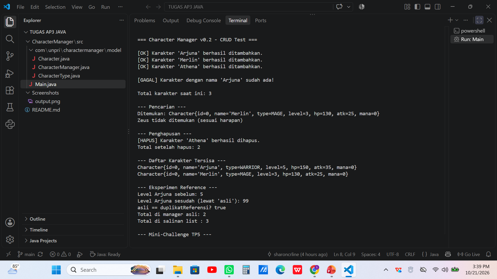
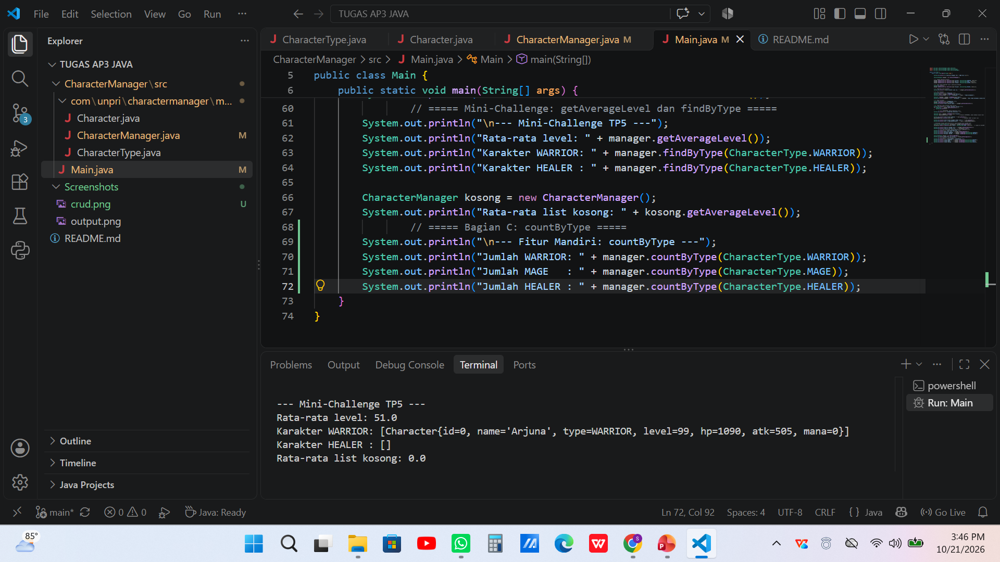
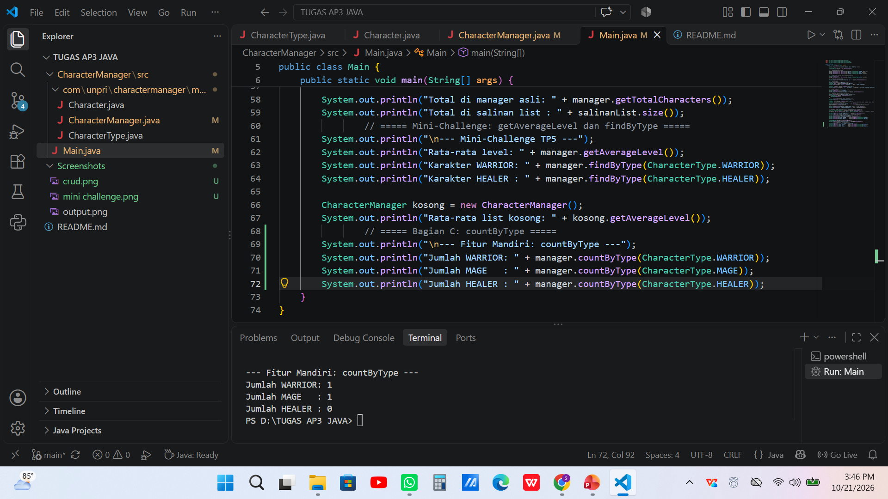

# Character Manager — TP3 (Java Visual SIH-6406)

Proyek ini adalah fondasi model class untuk aplikasi manajemen karakter game, ditulis dengan Java. Class `Character` menyimpan nama, jenis (enum `CharacterType`), level, hit points, attack power, dan mana, dengan statistik yang dihitung ulang otomatis saat level berubah. `Main.java` mendemonstrasikan pembuatan karakter, level up, serta fitur `mana` dan `isAlive()`.

## Screenshot Output


## Struktur Folder

```
javavisual-tp03-253303621274/
├── README.md
├── screenshots/
│   └── output.png
└── CharacterManager/
    └── src/
        ├── Main.java
        └── com/
            └── unpri/
                └── charactermanager/
                    └── model/
                        ├── Character.java
                        └── CharacterType.java
```

## Identitas

- Nama lengkap: Sharon Caroline Pardede
- NIM: 253303621274
- Analisis Bagian D (Google Docs): https://docs.google.com/document/d/1yYdo21ZE7nsQV2AhI6MQIll55f2BvhbNuB61EUNBLZk/edit?usp=sharing


---

# TP5 - Character Manager Sprint #2

### Fitur Baru
Pada TP5, saya mengembangkan Character Manager dengan menambahkan class `CharacterManager` untuk mengelola banyak karakter sekaligus, serta membuktikan bagaimana object reference bekerja. Fitur yang ditambahkan:

- `equals()`: membandingkan dua `Character` berdasarkan nama
- `addCharacter()`: menambah karakter dan menolak nama yang sudah ada
- `findByName()`: mencari karakter berdasarkan nama
- `removeCharacter()`: menghapus karakter berdasarkan nama
- `getTotalCharacters()`: menghitung jumlah karakter
- `getAllCharacters()`: mengembalikan salinan daftar karakter
- `getAverageLevel()`: menghitung rata-rata level, mengembalikan 0 jika daftar kosong
- `findByType()`: mencari semua karakter bertipe tertentu
- `countByType()`: menghitung jumlah karakter bertipe tertentu (fitur mandiri)

### Output Program

**CRUD dan Eksperimen Reference**

Pengujian CRUD membuktikan karakter dapat ditambah, dicari, dan dihapus, serta nama duplikat ditolak. Eksperimen reference membuktikan bahwa mengubah level lewat variabel lain ikut mengubah objek yang sama (level Arjuna berubah dari 5 menjadi 99). Sebaliknya, menambah elemen ke salinan daftar dari `getAllCharacters()` tidak mengubah daftar asli di manager (total manager tetap 2, total salinan 3).



**Mini-Challenge**

`getAverageLevel()` menghasilkan 51.0 untuk dua karakter berlevel 99 dan 3, dan 0.0 untuk daftar kosong tanpa error pembagian nol. `findByType()` mengembalikan karakter bertipe WARRIOR dan daftar kosong untuk HEALER.



### Fitur Mandiri: countByType()

**Alasan Memilih Fitur**

Saya memilih `countByType()` karena fitur ini berguna untuk mengetahui komposisi karakter yang dikelola, misalnya berapa banyak WARRIOR, MAGE, ARCHER, atau HEALER dalam daftar. Informasi ini membantu pengguna menyeimbangkan tim tanpa harus menghitung manual satu per satu. Fitur ini juga melengkapi `findByType()`: `findByType()` menjawab "siapa saja yang bertipe ini", sedangkan `countByType()` menjawab "berapa banyak".

**Cara Kerja**

Method `countByType(CharacterType type)` memeriksa setiap karakter di dalam daftar. Jika tipe karakter sama dengan tipe yang diminta, penghitung ditambah satu. Setelah seluruh daftar diperiksa, method mengembalikan jumlahnya sebagai `int`. Jika tidak ada karakter bertipe tersebut, hasilnya 0. Pada pengujian di `Main.java`, `countByType(WARRIOR)` menghasilkan 1, `countByType(MAGE)` menghasilkan 1, dan `countByType(HEALER)` menghasilkan 0.

**Penerapan Encapsulation**

Method ini hanya mengembalikan angka `int`, bukan `ArrayList` atau objek `Character`. Dengan begitu, kode di luar class `CharacterManager` tidak mendapat reference ke data internal dan tidak dapat mengubah daftar karakter tanpa melalui `addCharacter()` atau `removeCharacter()`. Hal ini berbeda dengan `findByType()` yang mengembalikan list berisi reference ke objek `Character` asli. Method ini juga dilengkapi Javadoc yang menjelaskan fungsi dan nilai kembaliannya.

**Keterbatasan**

Method ini hanya menghitung satu tipe dalam sekali pemanggilan, sehingga untuk melihat semua tipe perlu dipanggil beberapa kali. Method juga belum menangani nilai `null`: jika `type` berisi `null`, hasilnya 0 tanpa pesan kesalahan. Selain itu, hasilnya hanya angka, sehingga tidak ada informasi tentang siapa saja karakter yang dihitung (untuk itu dipakai `findByType()`).



### Analisis (Google Docs)

https://docs.google.com/document/d/1yctqVx_KpIS3zPsB3vbpmkmRFcUyT8DvgO4ybCgkYek/edit?tab=t.0