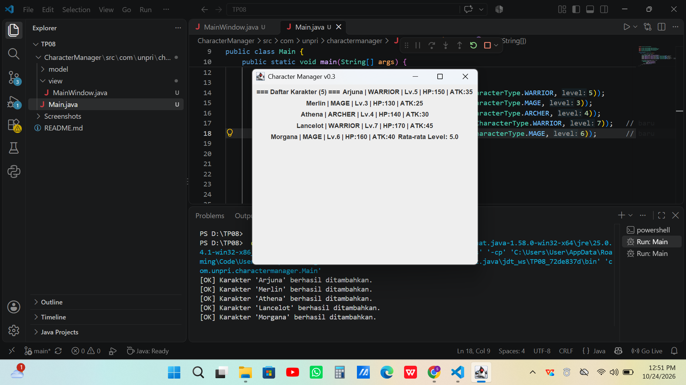
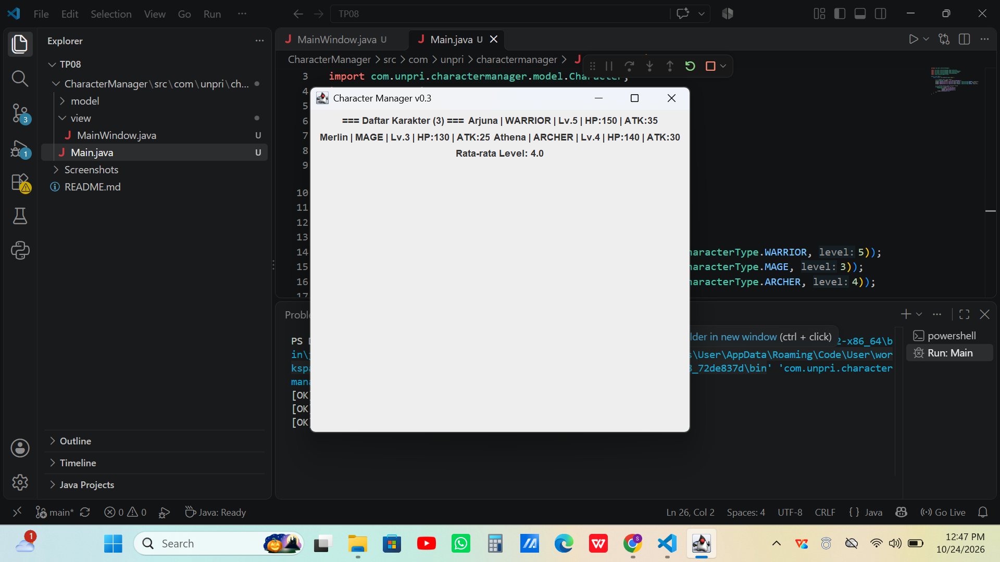

# Character Manager

Aplikasi manajemen karakter game berbasis Java dengan arsitektur MVC
(`model/`, `view/`, `controller/`).
Mata kuliah Java Visual.

**Nama:** Sharon Caroline Pardede 
**NIM:** 253303621274

## TP8 - MainWindow, Data Dinamis & MVC

### Tampilan MainWindow

Jendela menampilkan 5 karakter beserta label statistik "Rata-rata Level".
Sebagai bukti statistik bersifat dinamis, berikut tampilan sebelum data ditambah:

### Alur Data: Main → CharacterManager → MainWindow
Di `Main.java`, data dibuat lebih dulu dengan membuat objek `CharacterManager`
dan memanggil `addCharacter()` untuk tiap karakter (layer Model). Lalu `Main`
mengambil daftar karakter lewat `getAllCharacters()` dan nilai rata-rata lewat
`getAverageLevel()`, kemudian meneruskannya ke constructor `MainWindow`
di dalam `SwingUtilities.invokeLater()`. `MainWindow` (layer View) hanya
menerima data tersebut, melakukan loop untuk membuat satu `JLabel` per karakter,
dan menampilkannya tanpa menghitung apa pun sendiri. Dengan begitu View tidak
mengelola data dan tidak memuat logika bisnis, sesuai pemisahan tanggung jawab MVC.

### Karakter Baru
| Nama | Tipe | Level | Alasan Pemilihan |
|------|------|-------|------------------|
| Lancelot | WARRIOR | 7 | Dipilih level tinggi agar terlihat jelas pengaruhnya terhadap statistik: rata-rata level naik dari 4.0 menjadi 5.0. Tipe WARRIOR dipilih karena sudah ada Arjuna sebagai WARRIOR, sehingga bisa dicek bahwa dua karakter bertipe sama tetap tampil terpisah dan nilai HP/ATK-nya dihitung dari levelnya masing-masing. |
| Morgana | MAGE | 6 | Dipilih level menengah ke atas agar data lebih bervariasi dan rata-rata tidak hanya dipengaruhi satu karakter. Tipe MAGE dipilih untuk melengkapi Merlin, dan membuktikan bahwa daftar dinamis bisa menampilkan beberapa karakter dari tipe yang sama. |

### Analisis (Bagian D)
Link Google Docs: https://docs.google.com/document/d/1WVmngzsOWoh9T_Mm46afnY-ibliMNr3sEPrIgVUH9A4/edit?tab=t.0